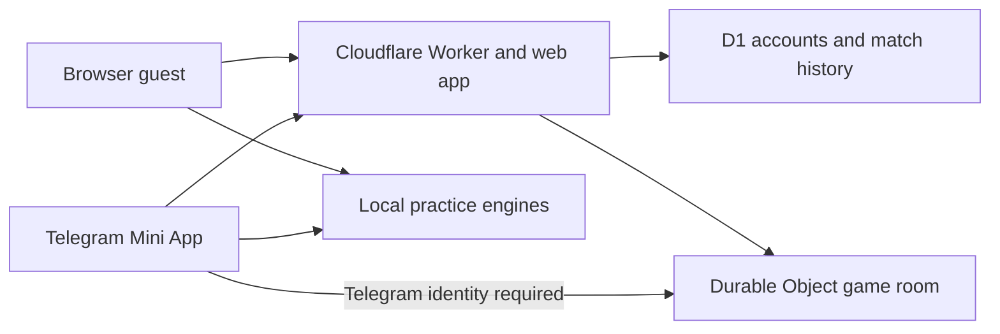

# DIRE BET architecture

Last updated: 2026-11-16

## Free-play app

- `apps/web` is the React and Vite player app. English, Amharic, Somali and Afaan Oromoo are included. The home carousel uses the supplied posters.
- `packages/engines` contains XO, Ludo, Dominoes and Texas Hold’em rules. Practice games run locally against bots.
- `apps/worker` verifies Telegram Mini App data, creates short-lived player sessions, serves the public catalog and handles room APIs.
- `GameRoom` is the authoritative Cloudflare Durable Object for private two-player rooms. It validates turns and game actions, uses server-generated room randomness, records match results/events in D1, and redacts private Poker and Dominoes state from player views.
- `Matchmaker` is the shared Durable Object for public rooms across XO, Ludo, Dominoes and heads-up Poker. It owns waiting-room state, server-side expiry, atomic seat assignment, demo-credit reservations/refunds, room events, and live public-list updates. When a room fills, it creates the existing D1 game-room record and starts `GameRoom` with the selected game and seat options; it does not implement a second game engine.
- Room creation accepts FREE or configured demo-credit amounts. Each room snapshots the configured 10% simulated commission. The single settlement path reads a completed result verified by `GameRoom`, records the simulated fee and payout once, and does not settle cancelled, expired, voided or disputed matches. Money calculations use integer tenths of a demo credit. The default custom amount cap is 1,000 demo credits.
- `migrations/0001_core.sql` creates the initial database. `0002_enable_freeplay_games.sql` enables the three additional free games in D1.
- `0003_player_registration.sql` adds optional web credentials and an encrypted contact record for Telegram registration.

## Authentication and staff routes

Telegram `initData` is HMAC-verified and age-checked before creating or updating a player record. In a private bot chat, users can share their own contact using Telegram's consent prompt. The bot verifies the contact belongs to the sender, encrypts the phone number with a key derived from `SESSION_SECRET`, and stores it in D1. The number is not returned by any API. A linked contact is required to create or join online rooms.

After sharing a contact, a user can set an optional web username and 8-digit PIN while signed in through Telegram. The PIN uses PBKDF2-SHA-256 with a random salt and a server-side pepper. Password sign-in is rate-limited to six attempts per username and 30 attempts per network per 15 minutes. Password sessions last 12 hours; Telegram sessions last 15 minutes. Forgotten web credentials can be reset from the Telegram account session. Private room requests also use a short-lived room ticket for WebSocket access.

`/admin` and `/agent` are browser-local demos. The admin preview generates a one-time password, stores a salted hash in local storage, and reviews fake receipt images saved in that same browser. Approval changes only the request label. The agent preview contains sample metrics and no real referral data. Production staff password/MFA enrollment, server-side permissions, invitations, and agent record isolation are not implemented.

The Rooms & Commissions panel calls server-backed room APIs. Those APIs require a valid player session whose Telegram numeric user ID matches the Worker setting `SUPER_ADMIN_TELEGRAM_ID`; the local demo-admin password does not authorize server-side room controls. Configure this variable with the owner's real Telegram user ID before the production panel can load or change settings. Room-setting changes and admin cancellations are recorded in the marketplace audit history. Admins cannot alter match results.

## Wallet and real-money boundary

`REAL_MONEY_ENABLED=false` and `DEMO_MODE=true`. The player wallet is informational only. There are no payment-provider routes or real balances, deposits, withdrawals, cash stakes or prizes. Room entry, commission and payout displays use non-redeemable demo credits only; the 10% commission is simulated and cannot be withdrawn. Do not change this boundary as part of a free-play deployment.

## Remaining operational work

The free-play build and migrations are deployed. The public room marketplace uses the existing `GameRoom` engine for all four available games. A production owner Telegram ID still needs to be configured for room administration. Two Telegram accounts are needed to verify contact registration and a public match end-to-end; use the protected setup script to refresh the bot webhook. Native-speaker translation review, production staff accounts, agent operations, monitoring and any future wallet service remain outside this free-play release. Ethiopian 41 has no engine and stays unavailable.
