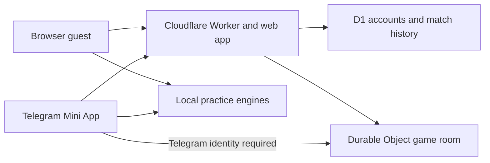

# DIRE BET architecture

Last updated: 2026-11-21

## Application and room services

- `apps/web` is the React and Vite player app. English, Amharic, Somali and Afaan Oromoo are included. The home carousel uses the supplied posters.
- `packages/engines` contains XO, Ludo, Checkers and Texas Hold’em rules. Practice games run locally against bots.
- `apps/worker` verifies Telegram Mini App data, issues signed player sessions with rotating refresh tokens, serves the public catalog and handles room APIs.
- `GameRoom` is the authoritative Cloudflare Durable Object for private two-player rooms. It validates turns and game actions, uses server-generated room randomness, records match results/events in D1, and redacts private Poker and Dominoes state from player views.
- `Matchmaker` is the shared Durable Object for public rooms across XO, Ludo, Checkers and heads-up Poker. It owns waiting-room state, server-side expiry, atomic seat assignment, wallet holds/refunds, room events and live public-list updates. When a room fills, it creates the D1 game-room record and starts `GameRoom` with the selected game and seat options.
- Free rooms remain available while paid entries are locked. After activation, room entries reserve real ETB from the D1 wallet ledger. Verified results pay the winner or split draws; voids, cancellations and expirations refund the original holds. Idempotency keys make retries safe. No room commission or agent cash commission is enabled.
- `migrations/0001_core.sql` creates the initial database. Migrations `0002` through `0009` add game, registration, review, wallet-ledger, SMS proof, simulation and room-stake schema. `0010_auth_sessions.sql` adds the additive `auth_sessions` table for hashed rotating refresh tokens.
- `0003_player_registration.sql` adds optional web credentials and an encrypted contact record for Telegram registration.

## Authentication and staff routes

Telegram `initData` is HMAC-verified before creating or updating a player record; the backend never trusts frontend identity claims. In a private bot chat, new users can share their own contact using Telegram's consent prompt. The bot verifies the contact belongs to the sender, encrypts the phone number with a key derived from `SESSION_SECRET`, and stores it in D1. The number is not returned by any API. A linked contact is required to create or join online rooms. `/start` skips the contact button and registration text when the user already has a verified contact, so returning users go straight to the menu.

After sharing a contact, a user can set an optional web username and 8-digit PIN while signed in through Telegram. The PIN uses PBKDF2-SHA-256 with a random salt and a server-side pepper. Password sign-in is rate-limited to six attempts per username and 30 attempts per network per 15 minutes. Telegram access tokens last 24 hours and password access tokens last 12 hours. Both sign-in paths also return a random 30-day refresh token; only its HMAC-SHA-256 hash is stored, in the additive `auth_sessions` table. Each renewal rotates the refresh token, revokes the previous one, and rejects reuse of a revoked token. Logout revokes the whole token family. The web client keeps the tokens in `localStorage`, refreshes proactively before expiry, retries one failed request after renewal, and persists a signed-out flag so logout survives reloads and Telegram auto-login does not immediately sign the user back in. Private room requests also use a short-lived room ticket for WebSocket access.

`/admin` requires the configured Super Admin Telegram identity and uses server-backed payment, activation, agent and room APIs. `/agent` shows real referral attribution only; agent earnings are disabled. The removed browser-local demo login and receipt store do not authorize or alter server records.

The Rooms panel calls server-backed APIs. These require a valid session whose Telegram numeric ID matches `SUPER_ADMIN_TELEGRAM_ID`. Configure it with the owner's personal Telegram ID before owner tools can be used. Setting changes, request reviews and cancellations are audited. Admins cannot alter match results.

## Wallet and activation boundary

- The application has server-controlled ETB balances in an append-only D1 ledger. Deposits require a Telebirr or eBirr reference and encrypted screenshot; an administrator must verify and approve before a database trigger credits the wallet. Withdrawals reserve funds when requested, support administrator approval/rejection, and require a manual transfer reference to mark payout complete. Duplicate references and request keys are rejected.
- P2P room holds, verified payouts and refunds also use that ledger. No payment provider API is integrated; deposit verification and withdrawal transfers are manual. Free play is available without an age review; real-money access still requires an approved 18+ age-eligibility record.
- `REAL_MONEY_ENABLED=false` and `DEMO_MODE=false` are the checked-in production settings. Migration `0006` clears the seeded payment numbers and disables both methods. The app serves free play; wallet and paid-room APIs refuse funds until real-money configuration and the immutable activation evidence gate both pass.

## Remaining operational work

This build was deployed on 2026-11-21 after applying `0010_auth_sessions.sql` to the remote D1 database. Before any live funds are enabled, complete every owner action in `LEGAL_ACTIVATION_CHECKLIST.md`, configure the owner account and payment details, verify the age-check method and retention policy, and run ledger/RBAC/age/provider reconciliation checks. Do not change the live-money flags while any approval is missing. Two Telegram accounts are needed for end-to-end room checks. Ethiopian 41 has no engine and stays unavailable.
