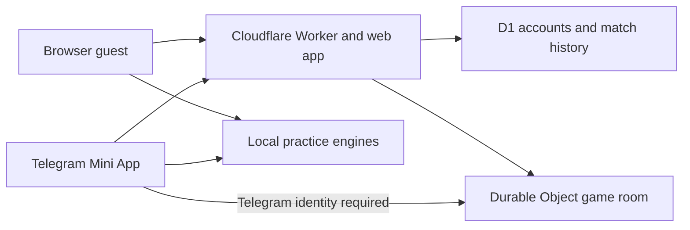

# DIRE BET architecture

Last updated: 2026-11-16

## Free-play app

- `apps/web` is the React and Vite player app. English, Amharic, Somali and Afaan Oromoo are included. The home carousel uses the supplied posters.
- `packages/engines` contains XO, Ludo, Dominoes and Texas Hold’em rules. Practice games run locally against bots.
- `apps/worker` verifies Telegram Mini App data, creates short-lived player sessions, serves the public catalog and handles room APIs.
- `GameRoom` is the authoritative Cloudflare Durable Object for private two-player rooms. It validates turns and game actions, uses server-generated room randomness, records match results/events in D1, and redacts private Poker and Dominoes state from player views.
- `migrations/0001_core.sql` creates the initial database. `0002_enable_freeplay_games.sql` enables the three additional free games in D1.

## Authentication and staff routes

Telegram `initData` is HMAC-verified, checked for age, then used to create or update a player record. Guest game sessions remain local. Private room requests require a signed Telegram session and a second short-lived room ticket for WebSocket access.

Admin and agent pages remain locked. There is no default admin credential. Staff password/MFA enrollment, server-side permissions, agent invitations, and agent record isolation need separate implementation before staff data can be used.

## Wallet and real-money boundary

`REAL_MONEY_ENABLED=false` and `DEMO_MODE=true`. The player wallet is informational only. There are no payment-provider routes or real balances, deposits, withdrawals, stakes, prizes or commissions. Do not change this boundary as part of a free-play deployment.

## Remaining operational work

The free-play build and migration are deployed. Two Telegram accounts are needed to verify an online match end-to-end; use the protected setup script to refresh the bot webhook. Native-speaker translation review, staff authentication, admin/agent operations, monitoring and any future wallet service remain outside this free-play release. Ethiopian 41 has no engine and stays unavailable.
