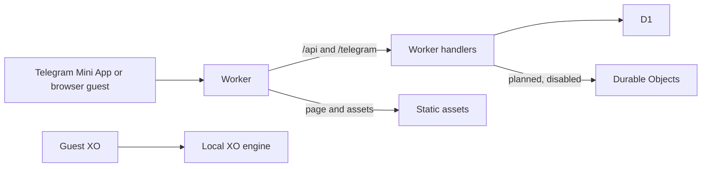

# DIRE BET architecture

Last updated: 2026-11-15

## Current preview

- `apps/web` is a React 18 and Vite application. The player shell is mobile-first and includes English, Amharic, Somali and Afaan Oromo dictionaries.
- `packages/engines` contains deterministic, client-only XO rules and a minimax practice bot. Guest practice does not write to the server.
- `apps/worker` is the Cloudflare Worker entry point. It serves the built app, a health response, a public game catalog, Telegram init-data verification, a signed short-lived session, the Telegram webhook and a protected setup endpoint.
- `migrations/0001_core.sql` creates the initial D1 schema, constrained game catalog, separate wallet types, and immutable ledger and audit-log triggers.
- Durable Object classes are declared for the planned room, matchmaking, presence and rate-limit services. Rooms and matchmaking return unavailable; they are not multiplayer services yet.

## Request path

## Authentication and security boundary

Telegram users send raw `initData` to `/api/auth/telegram`. The Worker verifies the Telegram HMAC, rejects stale data, upserts only the verified Telegram payload and signs a 15-minute HS256 session. A browser without a valid session stays a guest. The XO engine runs only in the browser and does not affect rankings, wallets or match history on the server.

The current session is held in page memory. Session persistence and administrative revocation are not implemented yet. Admin and agent routes return a locked preview and expose no records.

## Money and legal gate

`REAL_MONEY_ENABLED=false` and `DEMO_MODE=true` are the only checked-in defaults. Money routes return a denial unless both production variables and the recorded evidence plus immutable activation audit entry exist. Even with those fields, the current code has no provider payment integration and returns unavailable. Never change the gate until the checklist is complete, the feature exists and has passed its checks.

No deposit, withdrawal, wager, prize, cash commission or Telegram Stars flow is implemented. Demo and promo wallets are separate in the schema; real wallet operations are not exposed.

## Production work still required

Build and test server-authoritative Ludo, Dominoes and Texas Hold’em; secure admin password and MFA enrollment; server-side RBAC; agent invitations and row isolation; D1 transactions for wallet state; provider integrations and reconciliation; WebSocket tickets and game rooms; matchmaking; presence; notifications outbox; voice; disputes; support; age verification; rate-limit bindings; data retention; accessibility and browser QA. Ethiopian 41 must remain unavailable and has no engine or room path.
